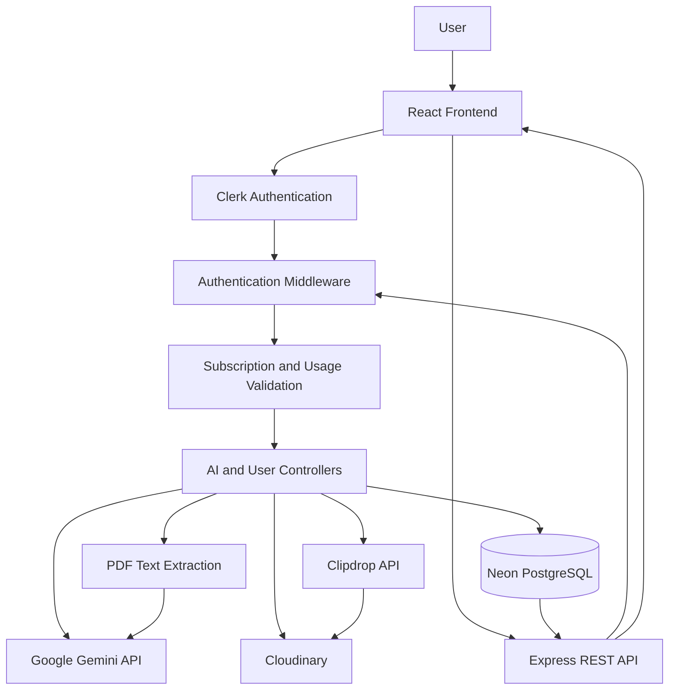
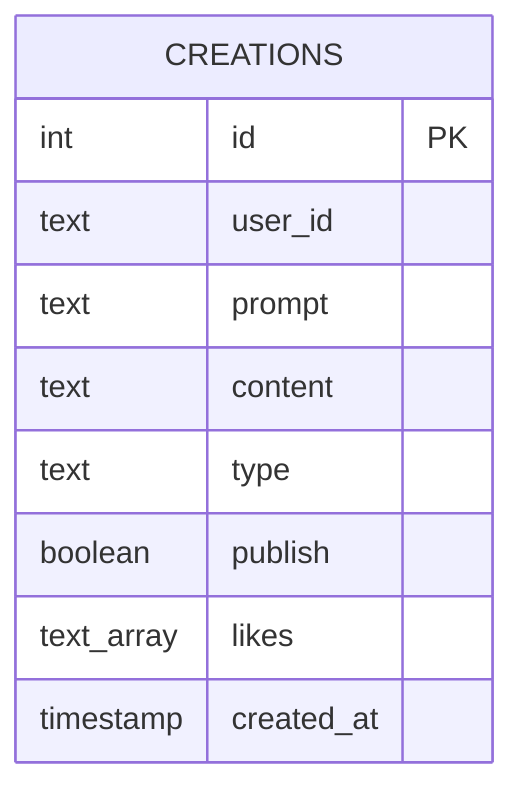
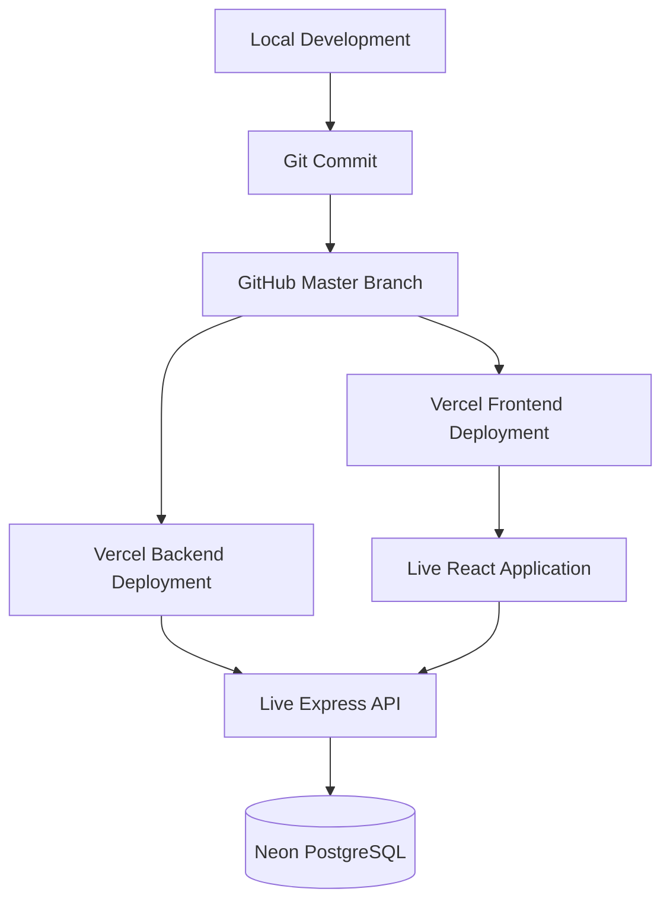

<div align="center">

# ✨ IntelliSaaS

### AI-Powered SaaS Platform for Modern Creators

Create smarter. Design faster. Work better.

An all-in-one, full-stack AI platform combining generative AI,
intelligent image processing, resume analysis, and subscription-based
access in a unified creative workspace.

[](https://arkastelinlisaas.vercel.app/)
[](https://github.com/d2r43/IntelliSaaS)


</div>

---

## 📖 Overview

**IntelliSaaS** is a full-stack AI-powered Software-as-a-Service
platform designed to simplify content creation, image editing,
and professional development.

The platform integrates multiple AI services into a single
responsive application, allowing users to generate articles,
create visual content, manipulate images, and receive
intelligent resume feedback.

IntelliSaaS implements user authentication, server-side
subscription authorization, usage tracking, persistent
database storage, and independently deployed frontend
and backend services.
---

## 🚀 Key Features

| Feature | Description |
|---|---|
| AI Article Writer | Generate articles based on custom topics and selected content length. |
| Blog Title Generator | Generate creative and engaging titles for blogs and articles. |
| AI Image Generator | Transform natural-language prompts into AI-generated images. |
| Background Removal | Automatically remove backgrounds from uploaded images. |
| Object Removal | Remove unwanted objects using AI-powered image transformations. |
| AI Resume Review | Analyze PDF resumes and receive constructive feedback. |
| Personal Dashboard | View previously generated content and creation history. |
| Community Gallery | Explore publicly shared creations and interact through likes. |
| Authentication | User registration, sign-in, session management, and social authentication. |
| Subscription Management | Free and Premium plans with backend-enforced access controls. |

## 📸 Application Screenshots

### Homepage


### Dashboard


### AI Article Writer


### AI Image Generator


### Resume Review


---

## 💳 Subscription Plans

IntelliSaaS follows a freemium SaaS model powered by Clerk Billing.

| Feature | Free | Premium |
|---|:---:|:---:|
| AI Article Writer | ✅ | ✅ |
| Blog Title Generator | ✅ | ✅ |
| Text Generation Limit | 10 combined generations | No application-level limit |
| AI Image Generation | ❌ | ✅ |
| Background Removal | ❌ | ✅ |
| Object Removal | ❌ | ✅ |
| Resume Review | ❌ | ✅ |
| Personal Dashboard | ✅ | ✅ |
| Community Gallery | ✅ | ✅ |

Free usage is tracked through Clerk user metadata.

Premium access is validated on the backend using the user's
subscription entitlement rather than relying exclusively
on frontend restrictions.

> AI service availability remains subject to provider quotas,
> credits, and service limitations. Billing currently operates
> in a Clerk development environment.
### Subscription Plans

---

## 🛠️ Technology Stack

### Frontend

| Technology | Purpose |
|---|---|
| React 19 | Component-based user interface |
| Vite | Frontend development and production build tooling |
| Tailwind CSS 4 | Responsive styling |
| React Router | Client-side navigation |
| Axios | HTTP requests and API communication |
| Clerk React SDK | Authentication and subscription UI |
| Framer Motion | Interface animations |
| Lucide React | Interface icons |
| React Hot Toast | User notifications |

### Backend

| Technology | Purpose |
|---|---|
| Node.js | JavaScript runtime |
| Express.js 5 | REST API development |
| Clerk Express SDK | Authentication and authorization |
| Neon Serverless Driver | PostgreSQL database connectivity |
| Multer | Multipart file upload handling |
| PDF Parse | Resume text extraction |
| OpenAI SDK | Google Gemini-compatible API communication |
| dotenv | Environment variable management |

### AI and Cloud Services

| Service | Purpose |
|---|---|
| Google Gemini | AI articles, blog titles, and resume analysis |
| Clipdrop | Text-to-image generation |
| Cloudinary | Image storage, background removal, and object removal |
| Neon | Serverless PostgreSQL database |
| Clerk | Authentication, user metadata, and subscriptions |
| Vercel | Frontend and backend deployment |
| GitHub | Version control and deployment integration |

---

## 🏗️ System Architecture



### Application Workflow

1. The user authenticates through Clerk.
2. The frontend sends an authenticated request to the Express API.
3. Backend middleware validates the user's identity.
4. Subscription entitlement and free usage limits are checked.
5. The appropriate AI service processes the request.
6. Generated content or image URLs are stored in PostgreSQL.
7. Results are returned to the frontend and displayed to the user.

---

## 📂 Project Structure

```text
IntelliSaaS/
│
├── client/
│   ├── public/
│   ├── src/
│   │   ├── assets/
│   │   ├── components/
│   │   │   ├── AiTools.jsx
│   │   │   ├── CreationItem.jsx
│   │   │   ├── Footer.jsx
│   │   │   ├── Hero.jsx
│   │   │   ├── Navbar.jsx
│   │   │   ├── Plan.jsx
│   │   │   └── Sidebar.jsx
│   │   ├── pages/
│   │   │   ├── BlogTitles.jsx
│   │   │   ├── Community.jsx
│   │   │   ├── Dashboard.jsx
│   │   │   ├── GenerateImages.jsx
│   │   │   ├── Home.jsx
│   │   │   ├── Layout.jsx
│   │   │   ├── RemoveBackground.jsx
│   │   │   ├── RemoveObject.jsx
│   │   │   ├── ReviewResume.jsx
│   │   │   └── WriteArticle.jsx
│   │   ├── App.jsx
│   │   └── main.jsx
│   ├── package.json
│   ├── package-lock.json
│   └── vercel.json
│
├── server/
│   ├── configs/
│   │   ├── cloudinary.js
│   │   ├── db.js
│   │   └── multer.js
│   ├── controllers/
│   │   ├── aiController.js
│   │   └── userController.js
│   ├── middlewares/
│   │   └── auth.js
│   ├── routes/
│   │   ├── aiRoutes.js
│   │   └── userRoutes.js
│   ├── server.js
│   ├── package.json
│   ├── package-lock.json
│   └── vercel.json
│
└── readme.md
```

---

## 🔌 REST API Reference

### Health Check

| Method | Endpoint | Description |
|---|---|---|
| GET | `/` | Verify backend availability |

### AI Endpoints

All AI endpoints require authentication.

| Method | Endpoint | Access |
|---|---|---|
| POST | `/api/ai/generate-article` | Free / Premium |
| POST | `/api/ai/generate-blog-title` | Free / Premium |
| POST | `/api/ai/generate-image` | Premium |
| POST | `/api/ai/remove-image-background` | Premium |
| POST | `/api/ai/remove-image-object` | Premium |
| POST | `/api/ai/resume-review` | Premium |

### User Endpoints

| Method | Endpoint | Description |
|---|---|---|
| GET | `/api/user/get-user-creations` | Retrieve authenticated user's creations |
| GET | `/api/user/get-published-creations` | Retrieve publicly available creations |
| POST | `/api/user/toggle-like-creation` | Like or unlike a published creation |

Authenticated API requests use Clerk session tokens.

```http
Authorization: Bearer YOUR_SESSION_TOKEN
```

Unauthorized requests receive an API-style `401` response.

---

## 🗄️ Database Design

IntelliSaaS uses Neon PostgreSQL to persist generated content,
image URLs, publication status, and community interactions.

### Creations Table



| Column | Description |
|---|---|
| id | Unique creation identifier |
| user_id | Clerk user identifier |
| prompt | Original user prompt |
| content | Generated text or image URL |
| type | Creation category |
| publish | Public visibility status |
| likes | Array of users who liked the creation |
| created_at | Creation timestamp |

Authentication records, subscription entitlements, and
free usage metadata are managed through Clerk.

---

## ⚙️ Local Installation

### Prerequisites

- Node.js 24 LTS recommended
- npm
- Git
- Google Gemini API credentials
- Neon PostgreSQL database
- Clerk application
- Cloudinary credentials
- Clipdrop API credentials

### 1. Clone the Repository

```bash
git clone https://github.com/d2r43/IntelliSaaS.git
cd IntelliSaaS
```

### 2. Install Frontend Dependencies

```bash
cd client
npm ci
cd ..
```

### 3. Install Backend Dependencies

```bash
cd server
npm ci
cd ..
```

### 4. Configure Environment Variables

Create a `.env` file inside the `server` directory.

```env
PORT=3000

# Neon PostgreSQL
DATABASE_URL=your_postgresql_connection_string

# Clerk Authentication
CLERK_PUBLISHABLE_KEY=your_clerk_publishable_key
CLERK_SECRET_KEY=your_clerk_secret_key

# Google Gemini
GEMINI_API_KEY=your_gemini_api_key

# Clipdrop
CLIPDROP_API_KEY=your_clipdrop_api_key

# Cloudinary
CLOUDINARY_CLOUD_NAME=your_cloud_name
CLOUDINARY_API_KEY=your_cloudinary_api_key
CLOUDINARY_API_SECRET=your_cloudinary_api_secret
```

Create another `.env` file inside the `client` directory.

```env
VITE_CLERK_PUBLISHABLE_KEY=your_clerk_publishable_key
VITE_BASE_URL=http://localhost:3000
```

> Never commit environment files or private credentials
> to version control.

### 5. Configure PostgreSQL

Create a Neon project and execute the following SQL
in the Neon SQL Editor:

```sql
CREATE TABLE IF NOT EXISTS creations (
    id SERIAL PRIMARY KEY,
    user_id TEXT NOT NULL,
    prompt TEXT NOT NULL,
    content TEXT NOT NULL,
    type TEXT NOT NULL,
    publish BOOLEAN DEFAULT FALSE,
    likes TEXT[] DEFAULT ARRAY[]::TEXT[],
    created_at TIMESTAMP DEFAULT CURRENT_TIMESTAMP
);
```

### 6. Configure Clerk

1. Create a Clerk application.
2. Configure your preferred authentication methods.
3. Obtain the publishable key and secret key.
4. Enable user billing.
5. Configure the default Free plan.
6. Create a Premium plan with the exact key `premium`.
7. Add the appropriate subscription features.

The frontend and backend must use credentials from
the same Clerk application and instance.

### 7. Start the Backend

Open a terminal from the repository root:

```bash
cd server
npm start
```

For development with automatic restart:

```bash
npm run server
```

Backend URL:

```text
http://localhost:3000
```

### 8. Start the Frontend

Open a second terminal from the repository root:

```bash
cd client
npm run dev
```

Frontend URL:

```text
http://localhost:5173
```

### 9. Production Build

```bash
cd client
npm run build
```

---

## ☁️ Cloud Deployment

The application is deployed using two independent
Vercel projects connected to the same GitHub repository.

| Configuration | Frontend | Backend |
|---|---|---|
| Platform | Vercel | Vercel |
| Root directory | client | server |
| Framework | Vite | Express |
| Production branch | master | master |

### Deployment Workflow



Configure environment variables independently for each
Vercel project.

The frontend's production `VITE_BASE_URL` must point
to the deployed Express backend.

---

## 🔐 Authentication and Security

The current implementation includes:

- Clerk-based identity and session management.
- Authenticated REST API endpoints.
- Server-side subscription entitlement validation.
- API-style unauthorized responses.
- Free usage tracking through private user metadata.
- Environment-based credential management.
- Separation of frontend and backend services.

Secret API credentials are intended for backend use only.

Additional production hardening, including restrictive CORS,
request rate limiting, stronger upload validation, and
automated security testing, is part of the future roadmap.

---

## 🧠 Engineering Highlights

- Integrated multiple external AI services within
  a unified application.
- Implemented subscription-based authorization
  at the API middleware layer.
- Designed a persistent PostgreSQL content storage model.
- Integrated PDF parsing with generative AI resume analysis.
- Implemented AI-generated image publishing and community likes.
- Separated authentication, controllers, routes, and
  service configurations.
- Deployed independent frontend and backend applications
  through GitHub-connected Vercel projects.

### Modernization and Maintenance

The application has undergone a compatibility and
infrastructure modernization process that includes:

- Migration to the Gemini 3.5 Flash-Lite model.
- Migration from the legacy Clerk React SDK to
  `@clerk/react`.
- Upgrade to Clerk Express SDK v2.
- Migration to `getAuth()` for backend authentication.
- Replacement of deprecated subscription UI checks.
- Database reprovisioning and schema reconstruction.
- Dependency and lockfile updates.
- Production build verification and cloud redeployment.

---

## 🧪 Validation

The latest Clerk migration completed the following checks:

- Clean frontend dependency installation.
- Clean backend dependency installation.
- Successful frontend production build.
- Backend JavaScript syntax validation.
- Clerk SDK compatibility checks.
- Git diff consistency checks.

Further automated integration, security, and
end-to-end testing remain planned improvements.

---

## 📈 Future Roadmap

- [ ] Production-grade authentication and billing
- [ ] Automated API and integration testing
- [ ] API rate limiting and abuse prevention
- [ ] Advanced usage analytics
- [ ] Improved subscription usage management
- [ ] AI response streaming
- [ ] Additional AI model integrations
- [ ] Prompt history and reusable templates
- [ ] Team workspaces and collaboration
- [ ] Docker-based development environment
- [ ] Enhanced monitoring and error tracking
- [ ] Accessibility and performance improvements

---

## 🤝 Contributing

Contributions, suggestions, and improvements are welcome.

1. Fork the repository.
2. Create a feature branch.

```bash
git checkout -b feature/your-feature
```

3. Commit your changes.

```bash
git commit -m "Add your feature"
```

4. Push the branch.

```bash
git push origin feature/your-feature
```

5. Open a pull request.

---

## 🙏 Acknowledgements

This project integrates technologies and services provided by:

- [React](https://react.dev/)
- [Express.js](https://expressjs.com/)
- [Google Gemini](https://ai.google.dev/)
- [Clerk](https://clerk.com/)
- [Neon](https://neon.tech/)
- [Cloudinary](https://cloudinary.com/)
- [Clipdrop](https://clipdrop.co/)
- [Vercel](https://vercel.com/)

---

## 👨‍💻 Developer

**Arkaprava Bhunia**

Computer Science | Full-Stack Development | Artificial Intelligence

---

<div align="center">

### ⭐ If you find this project interesting, consider starring the repository.

**IntelliSaaS — Empowering creativity through artificial intelligence.**

</div>
